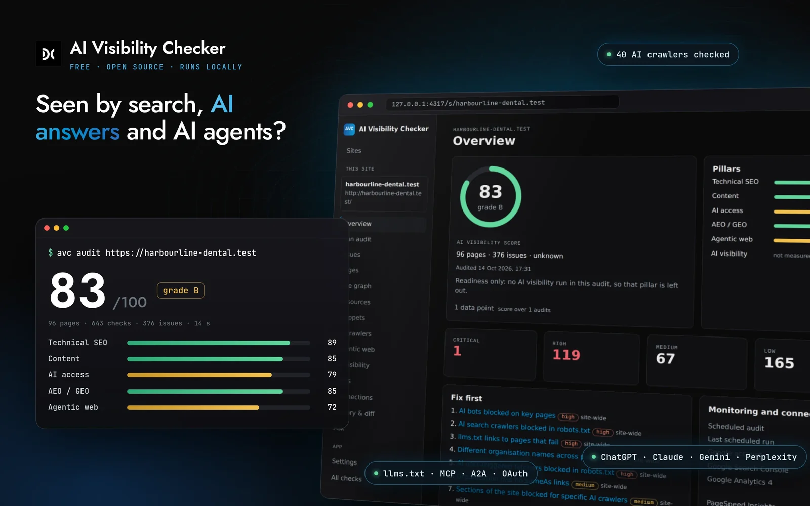
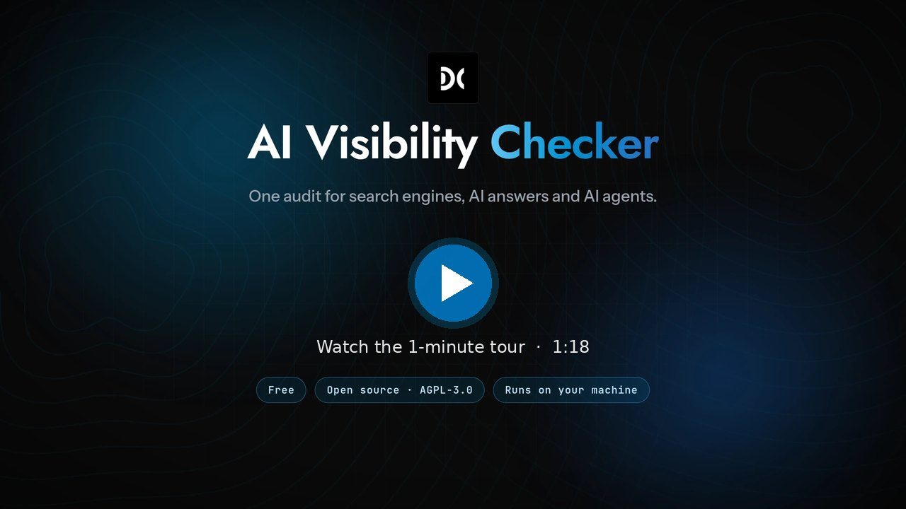
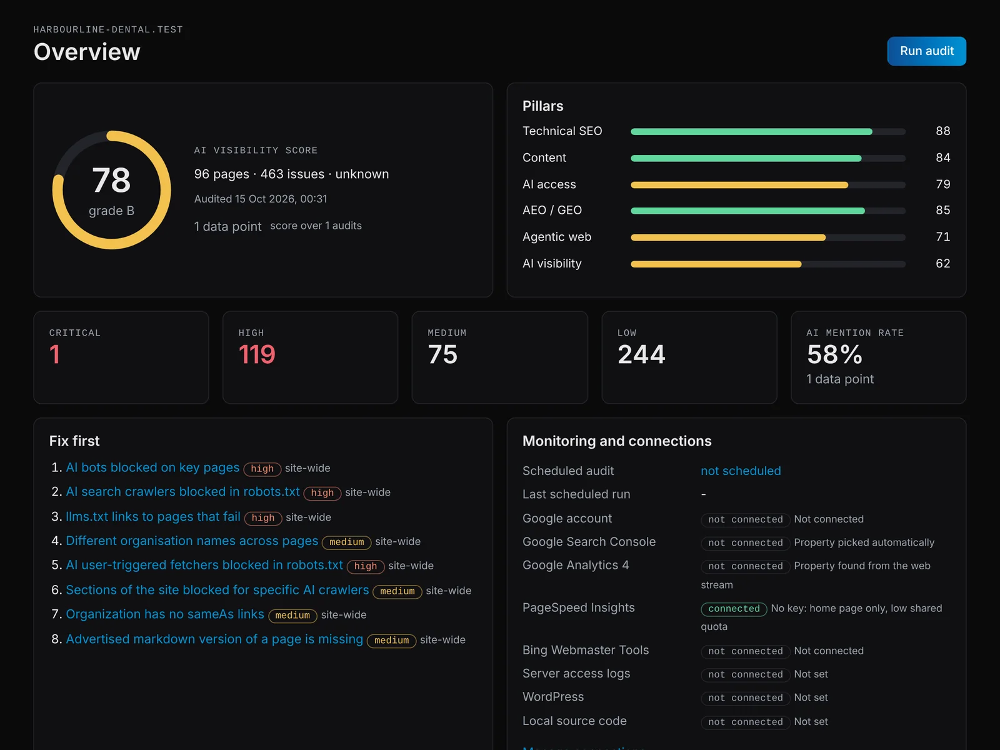
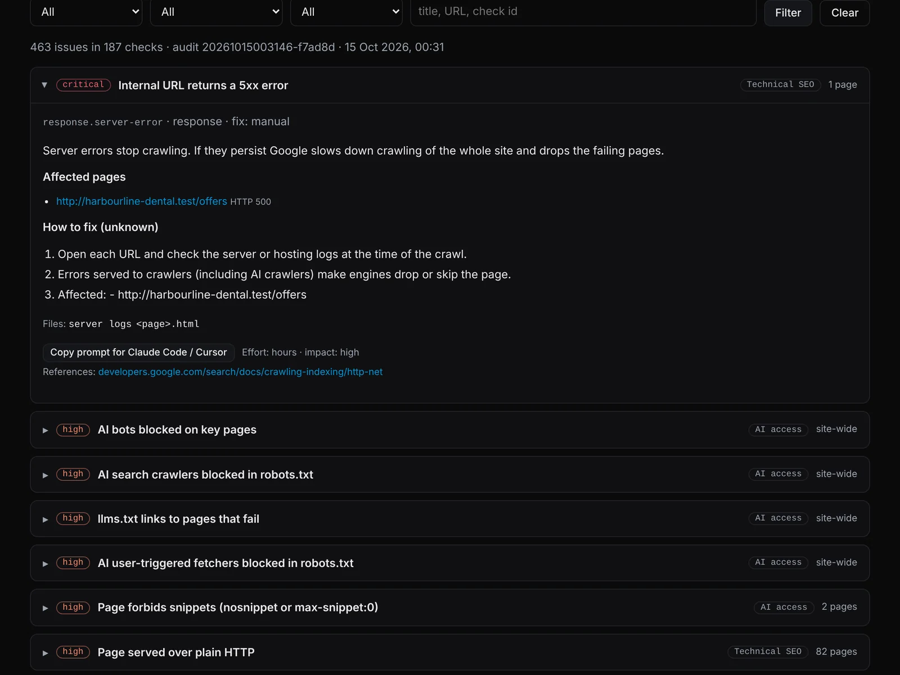
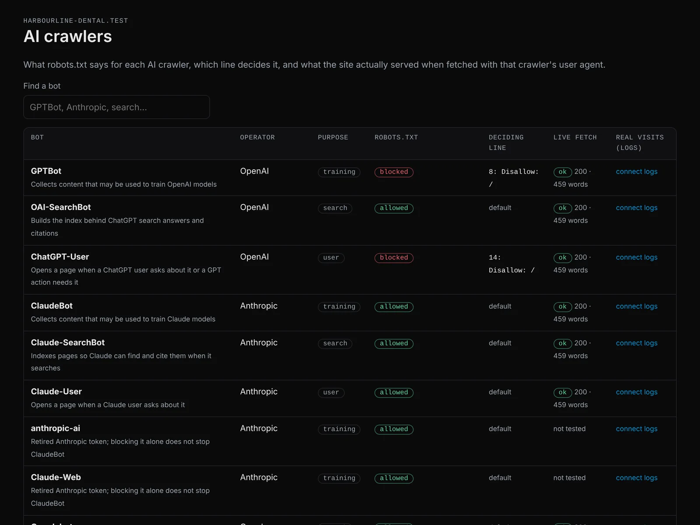
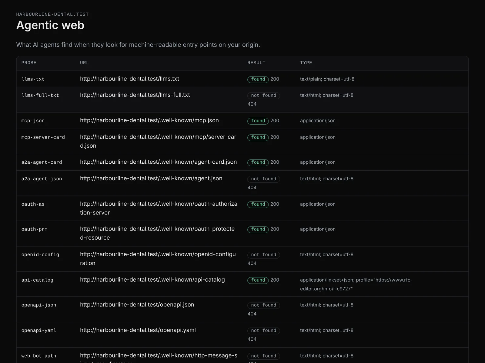
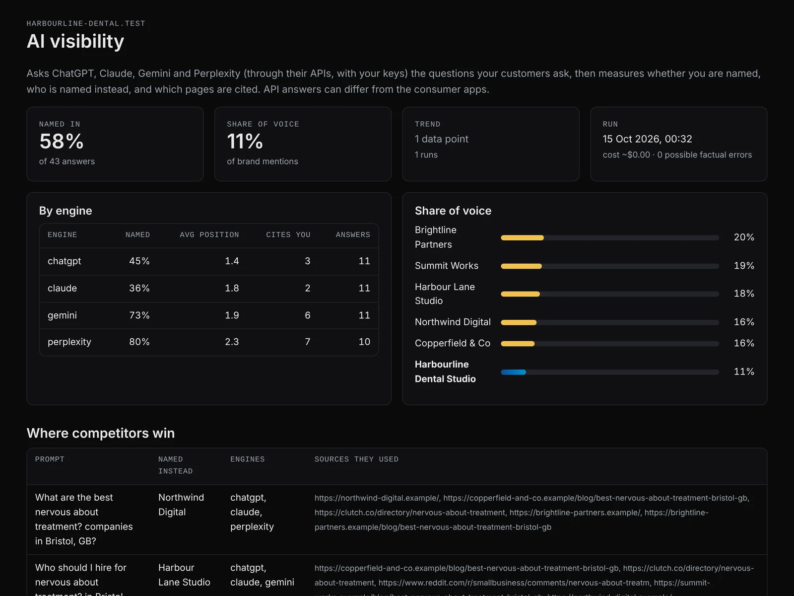
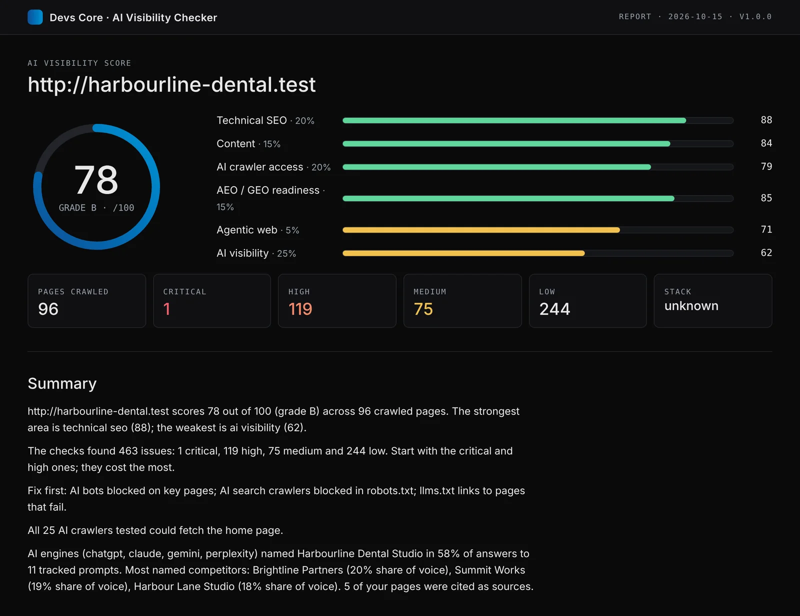

<div align="center">

<a href="https://devs-core.com/ai-visibility-checker"></a>

# AI Visibility Checker

**One audit for search engines, AI answers and AI agents.**

Crawl your whole site, see which AI crawlers can actually read it, find out whether ChatGPT,
Claude, Gemini and Perplexity name you or a competitor, and get fixes written for your stack.
Free, open source, and it runs on your machine.

[](LICENSE)
[](https://github.com/Devs-Core-Company/ai-visibility-checker/actions/workflows/ci.yml)
[](https://nodejs.org)


[](#benchmark)

<a href="https://www.producthunt.com/products/ai-visibility-checker-8?embed=true&amp;utm_source=badge-featured&amp;utm_medium=badge&amp;utm_campaign=badge-ai-visibility-checker-8" target="_blank" rel="noopener noreferrer"><picture><source media="(prefers-color-scheme: dark)" srcset="https://api.producthunt.com/widgets/embed-image/v1/featured.svg?post_id=1280880&amp;theme=dark&amp;t=1792032288603"></picture></a>

[Watch the tour](#see-it-run) · [Quickstart](#quickstart-60-seconds) · [Use it in Claude](#mcp-use-it-from-claude-cursor-or-vs-code) · [What you get](#what-you-get) · [Benchmark](#benchmark) · [Docs](docs/) · [Free web checker](https://devs-core.com/ai-visibility-checker)

</div>

```bash
npx github:Devs-Core-Company/ai-visibility-checker audit https://yoursite.com
```

That one line crawls the site, runs every check, and writes an HTML and JSON report to
`./avc-reports`. No account, no sign-up, no API key needed for the audit.

|                                        643 checks                                        |                                  40 AI crawlers                                   |                           4 AI engines                           |                                       121 / 121                                        |
| :--------------------------------------------------------------------------------------: | :-------------------------------------------------------------------------------: | :--------------------------------------------------------------: | :------------------------------------------------------------------------------------: |
| technical SEO, content, accessibility, AI access, AEO/GEO and agentic web, on every page | robots.txt rule and deciding line for each, live fetch as the 25 that fetch pages | ChatGPT, Claude, Gemini and Perplexity, asked with your own keys | planted defects found in an [open benchmark](#benchmark); the next best tool found 48% |

## See it run

<a href="https://www.youtube.com/watch?v=HW0-TYBymHQ"></a>

One command audits every page. The dashboard explains each issue, shows the robots.txt line that
blocks each AI crawler, checks agentic-web endpoints and AI visibility, and writes fixes for your
stack. Recorded on the benchmark demo site, which has planted issues; the AI answers shown are the
app's sample mode. [Watch on YouTube](https://www.youtube.com/watch?v=HW0-TYBymHQ) (1:18).

## Who it is for

- **Site owners and marketers** who want to know why AI assistants recommend a competitor and not them.
- **Developers** who want fixes as code for their stack (Next.js, WordPress, Shopify, Astro, Nuxt and
  more), a prompt they can paste into Claude Code or Cursor, and a CI gate.
- **Agencies** who run the same audit on many client sites and track them over time.

## Quickstart (60 seconds)

You need [Node.js](https://nodejs.org) 22.5 or newer. Chrome is optional (for JavaScript rendering).

**1. Install.** The one-line installer checks Node, installs the `avc` command, runs `avc doctor`
and connects AVC to Claude (step 3) if you have it:

```bash
# macOS / Linux
curl -fsSL https://raw.githubusercontent.com/Devs-Core-Company/ai-visibility-checker/main/install.sh | bash
```

```powershell
# Windows (PowerShell)
irm https://raw.githubusercontent.com/Devs-Core-Company/ai-visibility-checker/main/install.ps1 | iex
```

Or with npm: `npm i -g github:Devs-Core-Company/ai-visibility-checker`

**2. Audit your site.**

```bash
avc init          # your site, brand and competitors
avc audit yoursite.com
avc ui            # the dashboard, at http://127.0.0.1:4317
```

**3. Use it in Claude (desktop app, Claude Code or Cursor).** AVC is also an MCP server, so you can
ask Claude to audit your site and fix what it finds. One command connects it to the Claude desktop
app, Claude Code (in every folder) and Cursor, whichever you have:

```bash
avc setup-claude
```

**Quit the Claude app before running it** (⌘Q on a Mac, File → Exit on Windows; closing the window
is not enough) and open it again afterwards: a running app writes its old settings back over the
change. `avc setup-claude` warns and waits if the app is running. In a new chat, ask: _"Audit https://yoursite.com with avc and tell me the
three things to fix first."_ The installer in step 1 has already done this unless you set
`AVC_SKIP_CLAUDE=1`. More in [docs/MCP.md](docs/MCP.md).

Docker (Chromium included, data in a volume):

```bash
docker build -t avc https://github.com/Devs-Core-Company/ai-visibility-checker.git
docker run --rm -v avc-data:/data -v "$PWD/avc-reports:/app/avc-reports" avc audit https://yoursite.com
```

Step-by-step setup per operating system: [docs/INSTALL.md](docs/INSTALL.md).

## What you get

Screens from a real audit of the benchmark demo site (`harbourline-dental.test`, 96 pages with
planted issues). AI visibility is shown in sample mode, without API keys.

<table>
  <tr>
    <td width="50%" valign="top">
      
      <p><b>Overview.</b> One score across six pillars, issues by severity, and the fixes to do first, ranked by impact.</p>
    </td>
    <td width="50%" valign="top">
      
      <p><b>Issues with fixes.</b> Why each one matters, the pages affected, steps for your stack, the files to touch, and a prompt to paste into Claude Code or Cursor.</p>
    </td>
  </tr>
  <tr>
    <td width="50%" valign="top">
      
      <p><b>AI crawlers.</b> Every AI bot with its operator and purpose, what robots.txt decides, the exact line that decides it, and what the site really served it.</p>
    </td>
    <td width="50%" valign="top">
      
      <p><b>Agentic web.</b> What AI agents find at your origin: llms.txt, MCP server card, A2A agent card, OAuth discovery, API catalogue, Web Bot Auth.</p>
    </td>
  </tr>
  <tr>
    <td width="50%" valign="top">
      
      <p><b>AI visibility.</b> How often each engine names you, your share of voice, and the exact prompts where a competitor wins, with the sources it used.</p>
    </td>
    <td width="50%" valign="top">
      
      <p><b>Report to share.</b> A single offline HTML file with the score, the summary and every issue, plus Markdown, CSV, JSON, SARIF, Excel and PDF exports.</p>
    </td>
  </tr>
</table>

## What it checks

643 checks: 447 technical SEO, content, accessibility and CMS checks, and 196 AI
crawler, llms.txt, AEO/GEO, entity and agentic-web checks. Every check has a stable id, a severity, the reason it matters, and a fix. List them all with
`avc checks` (or `avc checks --json`). Checks that need data you have not connected are skipped
with a reason, never failed.

### 1. Technical SEO breadth

Crawlability and indexability (robots.txt, meta robots, `X-Robots-Tag`, noindex conflicts, orphan
pages, depth), response codes and redirect chains, canonicals, titles, meta descriptions and headings,
duplicate and thin content, internal and external links, images, structured data (JSON-LD, Microdata,
RDFa), hreflang, mobile, performance and Core Web Vitals, security headers and mixed content, URL
hygiene, XML sitemaps, pagination, accessibility basics, JavaScript rendering gaps, analytics and CMS
specifics.

### 2. Full-site coverage

A real crawler, not a one-page scan: follows links and sitemaps, respects robots.txt, renders
JavaScript pages in local Chrome when you ask (`--render`, or `auto` for a sample plus pages with
little raw text), and compares raw HTML with the rendered page, because most AI crawlers do not run
JavaScript. Rendered pages are also opened as a phone (tap targets, sideways scrolling, pop-ups,
content missing on mobile). Set `--max-pages 0` for no limit.

Crawl controls when you need them: list mode (`--list`), sitemap-only, platform presets
(`--preset auto`), URL rewriting and parameter stripping, subdomains or one folder, URL limits,
form sign-in for members' areas, custom extraction (CSS, simple XPath, regex), content-area
selectors, linked PDFs (title, author, pages), named crawl profiles, and `avc import` for a
Screaming Frog export.

### 3. AEO / GEO readiness

Whether pages answer questions directly (answer-first leads, question headings, FAQ and HowTo
structure), whether your entity is clear (Organization schema, `sameAs`, consistent name and
contact details), freshness signals, and whether pages are easy to quote and cite.

### 4. AI crawler access

40 AI and search crawlers (GPTBot, OAI-SearchBot, ChatGPT-User, ClaudeBot, Claude-SearchBot, PerplexityBot,
Google-Extended, Applebot-Extended, Bytespider, CCBot, Meta and Amazon bots and more), each with its
operator and purpose (training, search, user-triggered fetch). For each one: what robots.txt decides
and **which line decides it**. For the 25 that fetch pages, a **live fetch of your pages as that
bot**, compared with a
browser fetch, to catch firewalls, bot challenges (Cloudflare, Akamai, DataDome) and content that
differs. With server logs connected: **verified real visits** (IP ranges and reverse DNS), spoofed
user agents, errors served to bots, and key pages no AI bot has fetched.

### 5. Agentic-web readiness

`llms.txt` (presence, structure and a grade), `llms-full.txt`, MCP server card, A2A agent card, OAuth
protected-resource and authorisation-server discovery, Web Bot Auth, markdown content negotiation,
WebMCP form annotations, and commerce rails for agents.

### 6. Actionability: fixes you can apply

- **Stack-aware fixes.** The stack is detected (Next.js app or pages router, WordPress with Yoast or
  Rank Math, Shopify, Webflow, Astro, Nuxt, static and more), and each fix names the files to change
  with a copy-paste snippet for that stack.
- **Agent prompts.** Every fix has a ready prompt for Claude Code, Cursor or Copilot.
- **Auto-apply to WordPress** (titles, descriptions, canonicals and more through the REST API with an
  application password), with a **rollback snapshot** saved before every change.
- **Patches to a local repo**, previewed as a diff first.
- **Generators** for llms.txt, robots.txt AI rules, Organization/WebSite JSON-LD and an A2A agent card.

### 7. Ongoing monitoring

Scheduled audits and AI visibility runs (`avc schedule`, `avc monitor`, or your system scheduler),
diffs between any two audits, trends, and alerts by webhook (Slack, Discord, Teams) or email when the
score drops, a critical issue appears, a key page goes noindex, an AI bot gets blocked, robots.txt or
llms.txt changes, or a competitor overtakes you. Plus a GitHub Action for CI.

### Plus: real AI visibility tracking

Readiness is half the picture. `avc visibility` asks the engines the questions your customers ask,
using **your own API keys** (OpenAI, Anthropic, Google, Perplexity, xAI) or **one Vercel AI Gateway
key**, and measures:

- **mention rate** and average position, per engine,
- **share of voice** against your competitors,
- **competitor wins**: prompts where a competitor is named and you are not, with the sources they used,
- **citations**: which of your pages are cited, and which other domains are,
- **sentiment** and **fact-checks** of what the engines say about you, against your own site,
- **why not you**: likely gaps per prompt, and the pages to create or improve,
- **repeated runs** (`--repeats`) to see how much answers vary.

Answers come from the providers' APIs (with web search where the engine supports it). They are
samples, not recordings of the consumer apps, and can differ from what a person sees.

## Benchmark

We tested AVC against four widely used free or open-source audit tools on the same site, on the
same machine, under rules written before any tool ran ([bench/SPEC.md](bench/SPEC.md)). Everything
is in [`bench/`](bench/) so anyone can rerun it: the test site, the ground truth with a public
source for every defect, the runner for each tool, the mapping tables and the raw outputs.

**Result (13 October 2026):** AVC found all 121 planted defects with no false alarms on the
clean control pages. The next best tool, Scrawly, found 48%. On a 1,000-page site AVC matched
Scrawly's speed and memory while rendering every page twice (desktop and phone).

### What was measured

- **Detection.** An 86-page test site (a fictional dental practice) with **121 planted defects**
  in six areas and **12 clean control pages**. Defects come from public sources: Google Search
  Central, Lighthouse audits, WCAG 2.2, RFC 9309 (robots.txt), llmstxt.org, the A2A, MCP, OAuth
  and api-catalog specs, and the topic list of Scrawly's own check manifest, so every tool is
  tested on what it claims to cover. _Recall_ is the share of planted defects a tool reports.
  _Precision_ is the share of its matching findings that point at a real planted defect.
- **Speed and memory** on a generated 1,000-page site, full audit, each tool's defaults plus
  the settings a normal user needs to audit a whole site (listed in
  [RESULTS.md](bench/results/RESULTS.md)).

### Detection

| Tool                          | Defects found |   Recall | Precision | False alarms on clean pages |
| ----------------------------- | ------------: | -------: | --------: | --------------------------: |
| **AI Visibility Checker 1.0** | **121 / 121** | **100%** |   **88%** |                       **0** |
| Scrawly 1.0 (git 8fdebcf)     |      58 / 121 |      48% |       20% |                          45 |
| Google Lighthouse 13.5        |      31 / 121 |      26% |       51% |                           1 |
| Unlighthouse 0.19             |      27 / 121 |      22% |       46% |                           2 |
| python-seo-analyzer 2025.4.3  |       7 / 121 |       6% |       13% |                           5 |

Recall by area:

| Area (defects)           |      AVC | Scrawly | Lighthouse | Unlighthouse | python-seo-analyzer |
| ------------------------ | -------: | ------: | ---------: | -----------: | ------------------: |
| Technical SEO (40)       | **100%** |     63% |        28% |          23% |                  0% |
| Content and on-page (24) | **100%** |     71% |        13% |          13% |                 25% |
| Accessibility (17)       | **100%** |     41% |        88% |          82% |                  6% |
| AI crawler access (12)   | **100%** |     50% |         8% |           0% |                  0% |
| AEO / GEO readiness (15) | **100%** |      7% |         0% |           0% |                  0% |
| Agentic web (13)         | **100%** |     15% |         8% |           8% |                  0% |

### Speed and memory (1,000-page site)

| Tool                                                                     |       Pages audited |    Time | Peak memory |
| ------------------------------------------------------------------------ | ------------------: | ------: | ----------: |
| **AI Visibility Checker 1.0** (every page rendered on desktop and phone) |               1,006 | 3.9 min |    1,477 MB |
| Scrawly 1.0 (every page rendered once)                                   |               1,006 | 3.9 min |    1,490 MB |
| Unlighthouse 0.19                                                        | 28 (its own sample) | 4.7 min |    3,203 MB |
| Google Lighthouse 13.5                                                   |         50 (sample) | 9.6 min |    1,402 MB |
| python-seo-analyzer 2025.4.3 (no rendering)                              |               1,007 |    32 s |      202 MB |

On the 86-page detection site AVC took 68 s and Scrawly 32 s; python-seo-analyzer is the fastest
tool by far because it checks the least. Machine: 4 vCPU Intel Xeon 2.8 GHz, 15 GB RAM, Linux,
Node 22. Lighthouse-based tools were given a 50-page sample because a full run takes hours.

### Read this before quoting the numbers

- **We built both the tool and the test site.** To limit the bias: the site was built from
  public sources by a separate process that did not see AVC's check list; the rules, the
  mapping tables and every raw output are published; AVC changes made after a run must be
  general rules (no site-specific special cases) and are listed in
  [CHANGES.md](bench/results/CHANGES.md). AVC scored 77% in the first run; the gaps it showed
  were fixed with general, standards-based checks and the benchmark was rerun for every tool.
- **Commercial tools were not tested.** Screaming Frog, Sitebulb, Ahrefs and Semrush need paid
  licences or accounts and could not be run under the same conditions. We make no claims about
  them.
- **A planted-defect site is not the web.** It shows what each tool can detect, not how a real
  site will score. Lighthouse also measures lab performance in ways this suite does not reward.
- **AI visibility tracking is not in this benchmark.** None of the other tools asks AI engines
  anything, so there is nothing to compare.
- python-seo-analyzer stopped after 63 pages on the detection site with an internal error; its
  score is what it reported before stopping.

Rerun it yourself: [bench/RUNNING.md](bench/RUNNING.md). Full tables, including precision by
area and per-tool settings: [bench/results/RESULTS.md](bench/results/RESULTS.md).

## Free web version vs this app

Devs Core also runs a free web checker at
[devs-core.com/ai-visibility-checker](https://devs-core.com/ai-visibility-checker).

|                      | Free web checker                   | This app                                                                             |
| -------------------- | ---------------------------------- | ------------------------------------------------------------------------------------ |
| Install              | None, in the browser               | Node 22+, or Docker                                                                  |
| Which site           | Any URL                            | Your own sites                                                                       |
| Scope                | Instant scan of the page you enter | Full-site crawl, every page                                                          |
| AI visibility        | Sample, gated by email             | Your prompts, your engines, repeats, history                                         |
| JavaScript rendering | No                                 | Yes, with local Chrome                                                               |
| Connected data       | No                                 | Search Console, GA4, PageSpeed/CrUX, Bing, server logs                               |
| Fixes                | Advice                             | Stack-specific code, agent prompts, WordPress auto-apply with rollback, repo patches |
| Monitoring           | No                                 | Schedules, diffs, trends, alerts, GitHub Action                                      |
| Where it runs        | Devs Core servers                  | Your machine                                                                         |
| Cost                 | Free                               | Free (AGPL-3.0); AI checks use your own API keys                                     |

Use the web version for a quick look at any site; use this app to work on your own.

## Connections

All optional. Each one unlocks more checks. Setup for each: [docs/CONNECTIONS.md](docs/CONNECTIONS.md).

| Connection              | Command                                 | What it unlocks                                                          |
| ----------------------- | --------------------------------------- | ------------------------------------------------------------------------ |
| AI keys (or AI Gateway) | `avc ui` → Settings, or env vars        | Real AI visibility runs, prompt suggestions written from your site       |
| Google Search Console   | `avc connect google`, `avc connect gsc` | Clicks, impressions and queries per page; URL Inspection index status    |
| Google Analytics 4      | `avc connect ga4`                       | Sessions referred by ChatGPT, Perplexity, Gemini, Claude, Copilot        |
| PageSpeed Insights      | `avc connect psi`                       | Lab and field (CrUX) Core Web Vitals                                     |
| Bing Webmaster Tools    | `avc connect bing`                      | Bing crawl and index data (Copilot grounds on Bing); IndexNow submission |
| Server access logs      | `avc connect logs`, `avc logs <files>`  | Verified AI crawler visits, spoofed bots, errors served to bots          |
| WordPress               | `avc connect wordpress`                 | Auto-apply fixes with rollback                                           |
| Local repo              | `avc connect repo`                      | Fixes as patches to your code                                            |
| Chrome / Chromium       | install it, or `AVC_CHROME_PATH`        | Rendered vs raw HTML comparison, phone render, screenshots, PDF reports  |
| LanguageTool            | `avc connect spelling`                  | Spelling and grammar (your own server, or the public API if you opt in)  |
| Google Safe Browsing    | `avc connect safe-browsing`             | Outbound links to malware or phishing sites                              |
| Embeddings              | `avc connect embeddings`                | Pages with the same meaning; off-topic pages                             |
| Backlinks               | `avc connect backlinks`                 | Moz, Ahrefs or Majestic metrics from your own subscription               |

`avc doctor` shows what is set up and what is missing.

## Privacy

- Everything runs locally. Audits, history, OAuth tokens and snapshots live in `~/.avc` (or
  `AVC_DATA_DIR`) in a local SQLite database.
- The app only contacts: the sites you audit, and the APIs you configure (AI providers or the AI
  Gateway, Google, Bing, Wikidata for entity checks, LanguageTool, Safe Browsing, your backlink
  provider, your webhook or SMTP server). `avc update` reads the latest version from GitHub only
  when you run it.
- No telemetry, no analytics, no account.
- Secrets go in environment variables or `~/.avc/config.json` (file mode 600), never in the project
  file `avc.config.json`, which is meant to be committed.
- The dashboard listens on `127.0.0.1` only, needs a one-time session token, and rejects requests
  with an unexpected `Host` or `Origin` header.

## Costs

The app is free. AI visibility runs use your own keys and cost what your provider charges. Before a
run, the CLI and dashboard show an upper-bound estimate, and two hard caps stop spending: **per run**
(default $3) and **per calendar month** (default $30). Change them in Settings, `avc.config.json`
(`ai.maxRunUsd`, `ai.maxMonthUsd`) or `AVC_MAX_RUN_USD` / `AVC_MAX_MONTH_USD`. Use `--mock` to try
everything with sample answers and no spend. Prices in the estimate are list prices and can be out of
date; your provider's dashboard is the bill.

## MCP: use it from Claude, Cursor or VS Code

`avc setup-claude` ([Quickstart step 3](#quickstart-60-seconds)) connects AVC to the Claude desktop
app, Claude Code and Cursor. A plain `claude mcp add` only reaches Claude Code, in one folder, and
not the desktop app's chat; `avc setup-claude` handles both, with absolute paths so the desktop app
finds Node. VS Code and other clients: [docs/MCP.md](docs/MCP.md).

Then ask: "Audit example.com and fix the top three issues in this repo." Tools include `audit_site`,
`get_issues`, `get_fix` (with agent prompts), `crawler_access`, `agentic_readiness`, `ai_visibility`
(asks before spending), `diff_audits`, `list_audits`, `pagespeed`, `serp_preview`, `ask_audit`,
`generate_report`, generators, `plan_fixes` / `apply_fixes` (dry run unless confirmed),
`create_redirect` and `rollback`.

## CI

```yaml
- uses: Devs-Core-Company/ai-visibility-checker/.github/actions/avc-audit@main
  with:
    url: https://yoursite.com
    fail-under: 70
```

Or call the CLI directly: `avc audit https://yoursite.com --format sarif,md --fail-under 70` exits
with code 2 when the score is below 70. SARIF uploads to GitHub code scanning. See
[docs/GITHUB_ACTION.md](docs/GITHUB_ACTION.md).

## Commands

| Command                                                     | What it does                                                                   |
| ----------------------------------------------------------- | ------------------------------------------------------------------------------ |
| `avc init`                                                  | Set up a site: URL, brand, competitors                                         |
| `avc audit <url>`                                           | Crawl and check; reports in html, json, md, csv, sarif, xlsx, pdf              |
| `avc visibility <url>`                                      | Ask AI engines your prompts                                                    |
| `avc prompts suggest <url>`                                 | Suggest prompts to track                                                       |
| `avc fix [site]`                                            | Plan fixes; preview and apply to WordPress or a repo                           |
| `avc rollback <file>`                                       | Undo a WordPress change                                                        |
| `avc generate llms-txt\|robots\|schema\|agent-card <url>`   | Generate files                                                                 |
| `avc connect <source>`                                      | Connect Google, GSC, GA4, PSI, Bing, logs, WordPress, repo                     |
| `avc logs <files…>`                                         | AI crawler visits from access logs                                             |
| `avc diff`, `avc history`, `avc report`                     | Compare, list and export stored audits                                         |
| `avc schedule`, `avc monitor`                               | Scheduled audits with alerts                                                   |
| `avc ui`                                                    | Dashboard                                                                      |
| `avc mcp`, `avc setup-claude`                               | MCP server; connect it to Claude desktop, Claude Code and Cursor               |
| `avc checks`, `avc doctor`                                  | List checks; check your setup                                                  |
| `avc serp`, `avc ask`                                       | Snippet preview (pixel widths) and AI-written drafts; questions about an audit |
| `avc screenshot <url>`                                      | Desktop or phone screenshot                                                    |
| `avc import <csv>`                                          | Audit a Screaming Frog export                                                  |
| `avc redirect <site> <from> <to>`                           | Add a WordPress redirect (dry run first, rollback saved)                       |
| `avc presets`, `avc update`, `avc shortcut`, `avc feedback` | Crawl presets; update check; app icon; feedback                                |

Full reference: [docs/CLI.md](docs/CLI.md). Dashboard tour: [docs/DASHBOARD.md](docs/DASHBOARD.md).
How it compares with other tools: [docs/COMPARISON.md](docs/COMPARISON.md) (line by line with
Scrawly: [docs/PARITY.md](docs/PARITY.md)).

## FAQ

**Does it work on any website?** The audit works on any site you can reach. Auto-apply works on
WordPress and on sites whose source code you have locally; every other stack gets exact, copy-paste
fixes.

**Do I need AI keys?** No. Audits, crawler access, agentic checks and fixes need no keys. AI
visibility needs a key for each engine you want, or one AI Gateway key. Without keys it shows sample
answers so you can see how it works.

**Can I audit a site I do not own?** It is built for your own sites. Respect the site's terms and
robots.txt; the crawler identifies itself and respects robots.txt by default.

**How big a site?** You set the limit. Memory and time grow with pages; tens of thousands of pages
work on a normal laptop with rendering off.

**Is the score the same as the web checker's?** They share the idea, not the code path. This app sees
the whole site and connected data, so its score is more complete.

## Uninstall

```bash
avc uninstall
```

This removes AVC from the Claude desktop app, Claude Code and Cursor (other servers and settings in
those files are kept, with a backup), including entries Claude Code keeps for a single folder. It
removes the `avc shortcut` app launcher and any scheduled runs set up from `avc schedule`
(LaunchAgents, cron lines, Windows tasks; it lists them and asks first). It then asks whether to delete your stored API keys (yes by
default) and your audit history, settings, Google sign-in and WordPress rollback snapshots (no by
default). It deletes only files AVC created, never anything else in the folder. Finish with:

```bash
npm uninstall -g @devs-core/ai-visibility-checker
```

Options: `--yes` (ask nothing: delete keys, keep data), `--keep-keys`, `--delete-data`,
`--keep-data`. Installed as the Claude Desktop extension instead? Use Claude Desktop → Settings →
Extensions → AI Visibility Checker → **Uninstall**; then run `avc uninstall` too if you also
installed the `avc` command and want your keys and data gone.

**Quit Claude Desktop before running `avc uninstall`** (⌘Q / File → Exit). A running app writes its
in-memory settings back over the file and puts the `avc` entry back. `avc uninstall` checks for this:
it asks you to quit the app and press Enter (or continue anyway), and warns if the entry came back.
If it did, quit the app, run `avc setup-claude --remove --desktop` (before removing the program), or
delete the `avc` entry from `claude_desktop_config.json` by hand, then open the app again.

## Licence

GNU Affero General Public License v3.0 only (`AGPL-3.0-only`), © 2026 Devs Core. See
[LICENSE](LICENSE).

What that means in practice:

- **Using it for your own site, your clients' sites or in your CI is free, with no obligations.**
  Running the app does not require you to publish anything.
- **If you change the code and give the app to others, or run your changed version as a service
  other people use over a network**, you must offer those people the full source of your version
  under the same licence.
- **Want to embed it in a closed product or offer it as a hosted service without sharing your
  changes?** Devs Core offers commercial licences: contact@devs-core.com.

Versions published before 13 October 2026 (commit `f13a0c9` and earlier) were released under the
MIT licence and remain available under it.

Built by [Devs Core](https://devs-core.com). Contributions welcome: [CONTRIBUTING.md](CONTRIBUTING.md).
Security reports: [SECURITY.md](SECURITY.md).
